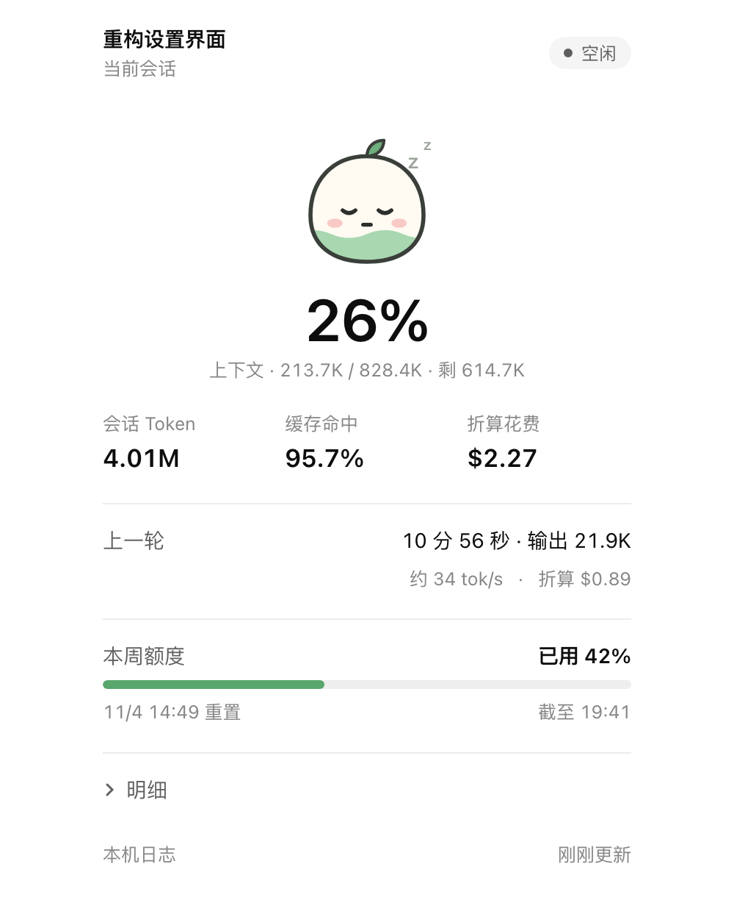
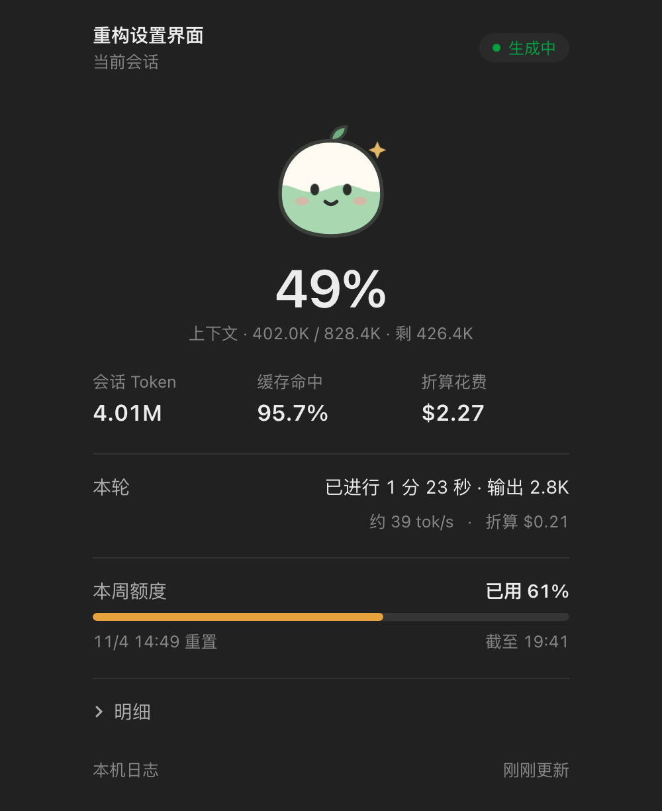
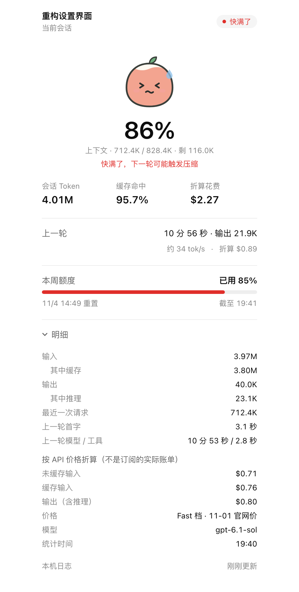

<p align="center"></p>

<p align="center"><b>English</b> · <a href="README.zh-CN.md">简体中文</a></p>

# Token Dango (Token 团子)

A conversation-panel plugin for the ChatGPT desktop app (Codex). It opens as a tab beside a conversation and shows how many tokens that conversation has used.

The liquid inside the dango is the conversation's context usage: matcha green below 60%, honey yellow from 60% to 80%, hawthorn red above 80%. Its face follows the conversation's state. It blinks while the model is generating, dozes when idle, sweats when context is nearly full, and shows a question mark when there is no data yet.

> This is an unofficial personal project, not affiliated with OpenAI. The panel's interface is in Chinese.

<table>
  <tr>
    <td align="center"><br><sub>Idle: the dango is napping</sub></td>
    <td align="center"><br><sub>Generating: blinking, liquid sloshing (dark mode)</sub></td>
    <td align="center"><br><sub>Nearly full: sweating and red, details open</sub></td>
  </tr>
</table>

<sub>Screenshots use demo data.</sub>

> 🍡 If the dango helped you see where your quota went, give it a ⭐. Stars are its favorite snack.

## What it shows

- **Context**: percentage, used / window size, remaining
- **Conversation totals**: total tokens, cache hit rate, equivalent API cost
- **Current or last turn**: duration, output tokens, approximate tok/s, equivalent cost
- **Account quota**: percentage used of the weekly or 5-hour window and its reset time, taken from the newest record across all conversations
- **Details**: input (of which cached), output (of which reasoning), size of the latest request, time to first token, model time vs. tool time, cost breakdown, price source

The panel uses the theme and style variables ChatGPT passes in, so it matches the app in light and dark mode. It refreshes every 2.5 seconds and pauses while the tab is hidden.

## Privacy

It only reads `~/.codex/state_5.sqlite`, `~/.codex/config.toml` and the conversation logs (rollout JSONL) on your Mac. The logs contain your chats, but the plugin only uses the usage and timing fields, and no chat content appears in the panel. It never reads `auth.json`, never writes any Codex file, and makes no network requests.

It runs on the `/usr/bin/python3` that ships with macOS and has no third-party dependencies.

## Requirements

- macOS with the ChatGPT desktop app (with Codex)
- Tested on ChatGPT 26.1027.51404 (bundled codex-cli 0.166.0-alpha.5.1)

## Install

```bash
git clone https://github.com/gKev1n/token-dango.git && cd token-dango
```

```bash
/Applications/ChatGPT.app/Contents/Resources/codex-cli/bin/codex plugin marketplace add "$PWD"
```

```bash
/Applications/ChatGPT.app/Contents/Resources/codex-cli/bin/codex plugin add token-dango@token-dango
```

Then **restart ChatGPT once**. Conversations that were already open before the install don't load new plugins, and they show "Couldn't display Token 团子".

## Open it

In any conversation, press ⌘T to open a new tab on the right, click "More tools", and choose "Token 团子". Once opened, the tab stays in that conversation.

## Update and uninstall

After changing the code or running `git pull`, remove and re-add the plugin so Codex refreshes its cache:

```bash
/Applications/ChatGPT.app/Contents/Resources/codex-cli/bin/codex plugin remove token-dango@token-dango
```

```bash
/Applications/ChatGPT.app/Contents/Resources/codex-cli/bin/codex plugin add token-dango@token-dango
```

To uninstall completely, run this after the remove:

```bash
/Applications/ChatGPT.app/Contents/Resources/codex-cli/bin/codex plugin marketplace remove token-dango
```

## How the two estimates work

**tok/s**: output tokens of the turn ÷ (turn duration − tool time). Tool time comes from the start and end times the log records for every command, tool call and sub-agent, with overlaps counted once. The result still includes time to first token, network latency and reasoning tokens, so it is a little lower than the model's raw generation speed. It is hidden when the turn produced fewer than 200 output tokens or less than 1 second of model time.

**Equivalent cost**: what the same usage would cost on the OpenAI API. **It is not your subscription bill.**

- Prices live in [`prices.json`](plugins/token-dango/prices.json), in USD per million tokens, copied from the [official pricing page](https://developers.openai.com/api/docs/pricing) on 2026-11-01. Edit that file when prices change.
- Each request is priced by its own input size: short-context prices up to 272K input tokens, long-context prices above that.
- The tier comes from the top-level `service_tier` in `~/.codex/config.toml`: `priority` is priced as Fast, anything else as Standard.
- Formula: (input − cached) × input price + cached × cached price + output × output price + cache writes × cache-write price. Reasoning tokens are already part of output and are not counted twice.
- Models missing from the price table show "—".
- Older conversations without per-request records are estimated from totals at short-context prices, which underestimates. The panel says so when this happens.
- Prices follow the conversation's current model, so a conversation that switched models midway will be off.

## Tests

```bash
cd plugins/token-dango && /usr/bin/python3 -m unittest discover -s tests -v
```

## Files

| File | Purpose |
| --- | --- |
| `plugins/token-dango/server.py` | MCP stdio server: declares the conversation-panel entry point, reads logs incrementally, returns usage snapshots |
| `plugins/token-dango/panel.html` | Panel UI: the dango, metrics and details |
| `plugins/token-dango/prices.json` | API prices per model (Standard / Fast × short / long context) |
| `plugins/token-dango/tests/test_server.py` | 19 tests: totals, half-written lines, replaced files, quota across conversations, running turns, overlapping tool time, per-request pricing, Fast tier, unknown models, totals fallback |

## Feed the dango

Found a bug or want a feature? Issues and PRs are welcome. If it's useful to you, a ⭐ makes the dango blink happily.

## License

[MIT](LICENSE)
